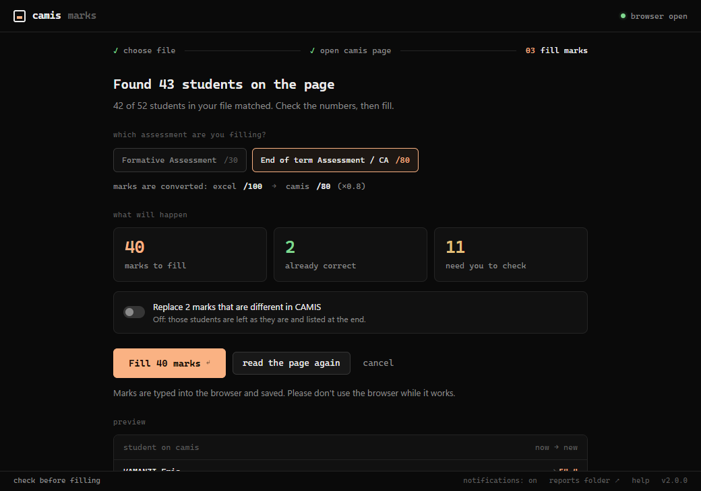
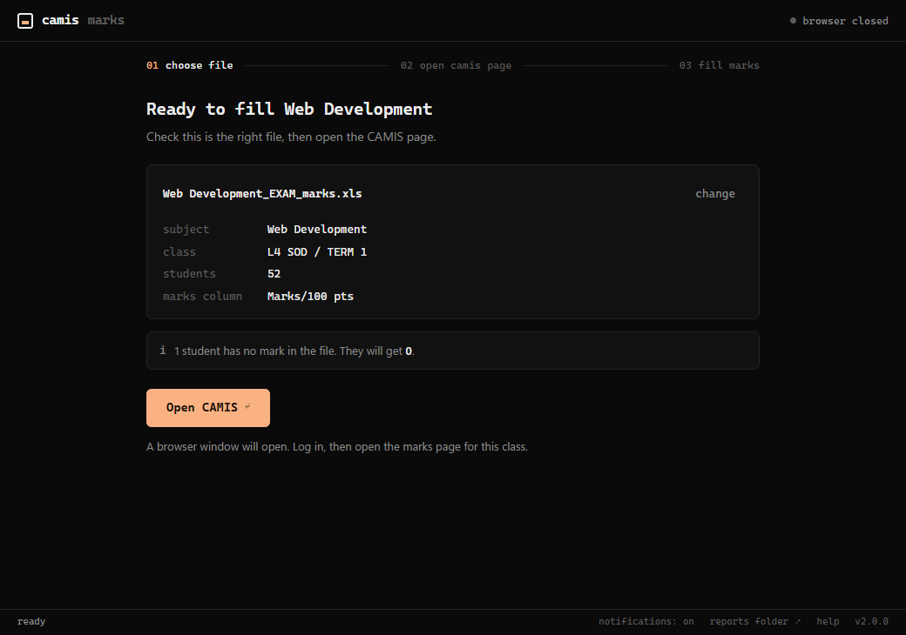
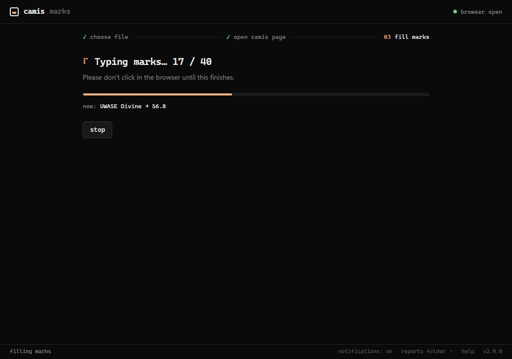
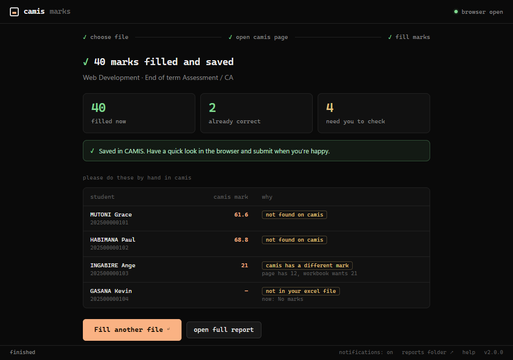

<div align="center">


# CAMIS Marks

**Fill CAMIS marks from an Excel sheet in three clicks.**

A Windows desktop app for teachers in Rwanda. It reads the marks exported from Urubuto or CAMIS
and types them into the NESA CAMIS marks recording page for you.

[](https://github.com/ndizeyedavid/camis-grader/releases/latest)
[](https://github.com/ndizeyedavid/camis-grader/actions/workflows/release.yml)


[Download](https://github.com/ndizeyedavid/camis-grader/releases/latest) &middot;
[How it works](#how-it-works) &middot;
[For developers](#for-developers) &middot;
[Changelog](CHANGELOG.md)

<br>



</div>

<br>

## Why

Entering marks into CAMIS means clicking every student, typing a number and converting it to the
assessment maximum by hand, for every class and every assessment. CAMIS Marks does that work
for you. You check the result and submit.

## Features

| | |
|---|---|
| **Three clicks** | Choose the file, open CAMIS, fill. Nothing else to configure. |
| **Automatic conversion** | Marks out of 100 in Excel go into a column out of 80 as mark x 0.8. Blank marks become 0. |
| **Smart matching** | Students are matched by name, then by student number, then by close spelling. |
| **Safe by default** | Marks already in CAMIS are never replaced unless you switch it on. Locked cells and absence reasons are left alone. |
| **Preview first** | See how many marks will be filled, which are already correct and which need you, before anything is typed. |
| **Clear follow up** | Students it could not fill are listed with the exact mark to type by hand. |
| **Notifications** | A Windows notification tells you when the page is found, when marks are saved, or when something needs you. |
| **Reports** | Every run is saved as a text and CSV report in `Documents\CAMIS Reports`. |
| **Stays logged in** | The browser keeps its own profile, so you log in once. Your personal browser is never touched. |

## Download and install

1. Open the [latest release](https://github.com/ndizeyedavid/camis-grader/releases/latest).
2. Download **CAMIS-Marks-Setup-x.y.z.exe** and run it. No administrator rights are needed.
3. Open **CAMIS Marks** from the Start menu or the desktop.

Prefer not to install? Download the **Portable** zip, unzip it anywhere and run `CAMIS Marks.exe`.

**Requirements:** Windows 10 or 11, Google Chrome or Microsoft Edge (Edge comes with Windows), and an internet connection.

> Windows SmartScreen may warn about an unknown publisher the first time, because the app is not
> code signed. Click **More info** and then **Run anyway**.

## How it works

<table>
<tr>
<td width="33%" valign="top">

**1. Choose the file**

Drop the Excel file on the window, click to browse, or pick one of the recent files the app finds in Downloads.

</td>
<td width="33%" valign="top">

**2. Open CAMIS**

A browser window opens. Log in, go to Marks recording and open the class. The app notices the student list by itself.

</td>
<td width="33%" valign="top">

**3. Fill marks**

Check the preview, pick the assessment if there are several, and click Fill. The marks are typed and saved.

</td>
</tr>
<tr>
<td></td>
<td></td>
<td></td>
</tr>
</table>

When it finishes, look over the marks in CAMIS and submit them yourself. The app never submits for you.
For the next class, click **Fill another file**. The browser stays open.

A short guide for teachers is included with the app: [HOW TO USE.txt](HOW%20TO%20USE.txt).

## Supported files

- The HTML style `.xls` export from CAMIS and Urubuto
- Split "Excel frameset" exports (the `.xls` file plus its `_files` folder)
- Regular `.xls` and `.xlsx` workbooks with a `Names` column and a `Marks` column

If a sheet has several marks columns, the rightmost one with a maximum in its header is used,
for example `Marks/100 pts`.

## For developers

### Project layout

```
app.py              Desktop app: pywebview window and a single browser worker thread
ui/index.html       The interface (HTML, CSS and JavaScript, works offline)
camis_grader.py     Engine: reads the workbook, reads the CAMIS table, matches, types, saves, reports
notify.py           Native Windows notifications and taskbar flashing
flatten_lesson.py   Repairs split frameset exports into one file
build_exe.py        PyInstaller build
installer/          Inno Setup script for the Windows installer
.github/workflows/  Release pipeline
```

### Run from source

```bash
python -m pip install -r requirements.txt
python app.py
```

The engine also works on its own from the command line:

```bash
python camis_grader.py --file "marks.xls" --dry-run
python camis_grader.py --help
```

### Build locally

```bash
python -m pip install -r requirements-build.txt
python build_exe.py
```

The app is written to `dist/CAMIS Marks/`. To build the installer as well, install
[Inno Setup 6](https://jrsoftware.org/isinfo.php) and run:

```bash
iscc /DAppVersion=2.0.0 installer\camis-marks.iss
```

### Testing without real CAMIS

Set the `CAMIS_URL` environment variable to a local copy of the marks recording page and the app
opens that instead of `https://camis.nesa.gov.rw/`.

### If CAMIS changes its page

Everything that depends on the CAMIS page layout lives in `camis_grader.py`:

- `EXTRACT_TABLE_JS` reads the student table
- `enter_mark()` clicks a cell and types the mark
- `save_marks()` finds and clicks **Save marks**

### Where the app keeps data

| What | Where |
|---|---|
| Reports | `Documents\CAMIS Reports` |
| Browser login | `%LOCALAPPDATA%\CAMIS Marks\browser-profile` |
| Settings and log | `%LOCALAPPDATA%\CAMIS Marks` |

## Releasing a new version

Releases are fully automated by [GitHub Actions](.github/workflows/release.yml).

1. Add a new section at the top of [CHANGELOG.md](CHANGELOG.md):

   ```markdown
   ## [2.1.0] - 2026-12-01

   ### Fixed
   - Describe the change.
   ```

2. Commit and push to `main`.

The workflow reads the newest version, builds the app on Windows, packages the installer and a
portable zip, and publishes them as release `v2.1.0` with the changelog section as release notes.
If that version was already released, nothing happens.

## Privacy

Everything runs on the teacher's own computer. Marks go only to CAMIS, through the browser
window you can see. Do not commit exported marks or reports to this repository; the
`.gitignore` excludes them.

## License

Released under the [MIT License](LICENSE). Provided as is, without warranty. Always review marks
in CAMIS before submitting them.
